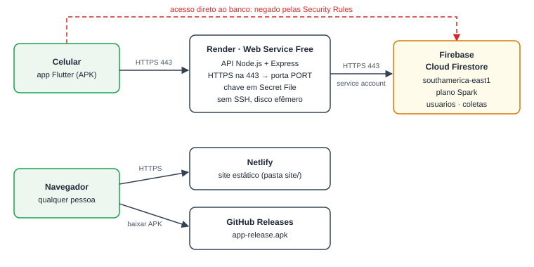

# 03 · Entender e montar a rede

**Objetivo:** entender por onde o tráfego do EcoColeta passa e deixar exposto só o que o app realmente precisa, mesmo sem ter um servidor próprio.

## Conceitos, com minhas palavras

Como uso serviços gerenciados, não existe VCN, subnet ou firewall de máquina para eu montar. Cada conceito de rede continua existindo, mas quem o implementa é o provedor. Para mim, cabe configurá-lo.

| Conceito | No EcoColeta |
|---|---|
| **Projeto** (equivalente ao compartment) | O projeto `ecocoleta-27def` do Google Cloud/Firebase agrupa o banco, as chaves e as permissões. Nada dele se mistura com outros projetos da conta. |
| **HTTPS / TLS** | Criptografa a conexão entre quem acessa e o serviço. O Render e a Netlify emitem e renovam o certificado sozinhos, e todo acesso usa a porta 443. |
| **DNS e domínio** | Traduz nome em endereço. A API responde em `ecocoleta-api-imd4.onrender.com` e o site em `ecocoleta-app.netlify.app`, subdomínios gratuitos dos provedores. |
| **Proxy reverso** | O Render recebe o HTTPS na porta 443 e repassa para a porta interna que ele informa à API pela variável `PORT`. Por isso o código usa `process.env.PORT`. |
| **Regra de entrada** | Quem pode **iniciar** uma conexão com o serviço. Na API e no site, qualquer pessoa na internet, só por HTTPS. |
| **Regra de saída** | Para onde o serviço pode **iniciar** conexões. A API sai para o Firestore pela porta 443. |
| **Service account** (IAM) | A identidade da API no Google. É ela, e não a minha conta pessoal, que tem permissão de acessar o banco. |
| **Security Rules do Firestore** | O "firewall" do banco para acesso direto de apps e navegadores. As minhas negam tudo, porque o app só fala com a API. |



## Regras de entrada

| Destino | Porta | Origem | Motivo |
|---|---|---|---|
| API (Render) | 443 (HTTPS) | qualquer origem | O app chama a API de qualquer rede, Wi-Fi ou 4G. O HTTP na 80 é redirecionado para HTTPS. |
| Site (Netlify) | 443 (HTTPS) | qualquer origem | Landing page pública, com o botão de download do APK. |
| Firestore | 443 | **só a API**, autenticada pela service account | O banco nunca é acessado pelo app. Acesso direto é negado pelas Security Rules. |
| SSH ou shell | nenhuma | ninguém | O plano Free do Render não tem SSH. Não existe servidor para alguém tentar invadir por essa porta. |

## Regra de saída

A API só inicia conexões com o Firestore, por HTTPS na porta 443, usando o Firebase Admin SDK. O Render não limita a saída no plano Free, mas a API não chama nenhum outro serviço.

## Security Rules do Firestore

```text
rules_version = '2';
service cloud.firestore {
  match /databases/{database}/documents {
    match /{document=**} {
      allow read, write: if false;
    }
  }
}
```

Essas regras negam toda leitura e escrita feita **diretamente** por apps e navegadores. A API não é afetada, porque o Admin SDK se autentica com a service account e não passa pelas regras. Assim, a proteção dos dados fica em um lugar só: a API, que valida tudo antes de gravar (capítulo 05).

## O que deu errado e como corrigi

O app funcionava rodando pelo `flutter run`, mas o **APK de release** não conectava em nada e todas as telas davam erro de conexão. A permissão de internet (`android.permission.INTERNET`) só existia no manifesto de depuração, que o Flutter cria sozinho. O manifesto principal, usado no release, não tinha essa permissão. Adicionei a linha no `android/app/src/main/AndroidManifest.xml` e o APK passou a acessar a API.

## Evidências


## Fontes

- Firebase. *Get started with Cloud Firestore Security Rules*. https://firebase.google.com/docs/firestore/security/get-started
- Firebase. *Add the Firebase Admin SDK to your server*. https://firebase.google.com/docs/admin/setup
- Google Cloud. *Service accounts overview*. https://cloud.google.com/iam/docs/service-account-overview
- Render. *Web Services* (porta e HTTPS). https://render.com/docs/web-services
- Android Developers. *Connect to the network*. https://developer.android.com/develop/connectivity/network-ops/connecting
