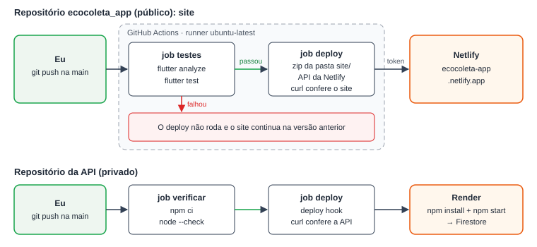

# 08 · Montar o CI/CD com GitHub

**Objetivo:** fazer um `push` no GitHub levar a mudança para o ar sem eu abrir nenhum painel, e só se os testes passarem.

**Repositório:** https://github.com/rafaellourenco10/ecocoleta_app (workflow em `.github/workflows/deploy.yml`)

## CI e CD

- **CI (Integração Contínua):** a cada mudança enviada, o código é verificado automaticamente. No app, isso é a análise estática (`flutter analyze`) e os testes dos validadores (`flutter test`).
- **CD (Entrega Contínua):** se a verificação passar, a mudança vai para o ar sozinha. Se falhar, nada é publicado.

Antes deste trabalho, o Render e a Netlify já publicavam sozinhos a cada push, mas **sem nenhum teste antes**: um erro iria direto para os usuários. Passei o controle para o GitHub Actions. Desliguei o deploy automático dos dois (**Auto-Deploy: Off** no Render e **Stop builds** na Netlify), e agora quem publica é o pipeline, depois dos testes.

No GitHub Actions, cada fluxo é um arquivo YAML na pasta **`.github/workflows/`** do repositório. O gatilho fica na chave `on:`. No meu caso: todo `push` na branch `main` (menos mudanças só em `docs/`, que não mudam o site) e também o botão manual `workflow_dispatch`.



## Workflow do site

```yaml
# CI/CD do site: testa o app Flutter e, se passar, publica o site na Netlify.
name: CI/CD do site

on:
  push:
    branches: [main]
    paths-ignore: ['docs/**']
  workflow_dispatch:

permissions:
  contents: read

concurrency: deploy-site

jobs:
  testes:
    runs-on: ubuntu-latest
    steps:
      - uses: actions/checkout@v4
      - uses: subosito/flutter-action@v2
        with:
          channel: stable
          cache: true
      - run: flutter pub get
      - run: flutter analyze
      - run: flutter test

  deploy:
    needs: testes
    runs-on: ubuntu-latest
    steps:
      - uses: actions/checkout@v4
      - name: Empacotar o site
        run: cd site && zip -r ../site.zip .
      - name: Publicar na Netlify
        env:
          NETLIFY_TOKEN: ${{ secrets.NETLIFY_AUTH_TOKEN }}
        run: >
          curl -fsS -o /dev/null
          -H "Content-Type: application/zip"
          -H "Authorization: Bearer $NETLIFY_TOKEN"
          --data-binary @site.zip
          https://api.netlify.com/api/v1/sites/ecocoleta-app.netlify.app/deploys
      - name: Verificar se o site respondeu
        run: curl -fsS --retry 5 --retry-delay 5 --retry-all-errors https://ecocoleta-app.netlify.app/ | grep -q EcoColeta
```

## Etapas e funções

| Etapa | Função |
|---|---|
| `on: push` / `workflow_dispatch` | Dispara a cada push na `main` ou pelo botão "Run workflow". |
| `permissions: contents: read` | O token automático do GitHub só consegue ler o repositório. |
| `concurrency` | Dois pushes seguidos não publicam ao mesmo tempo. |
| **job `testes`**: `checkout` | Baixa o código do commit. |
| `flutter-action` | Instala o Flutter no runner, com cache para as próximas execuções. |
| `flutter analyze` | Análise estática: erros e más práticas (regras do `flutter_lints`). |
| `flutter test` | Roda os testes de CPF/CNPJ, e-mail, telefone e senha. |
| **job `deploy`**: `needs: testes` | Só começa se o job `testes` passar. É o portão entre CI e CD. |
| Empacotar o site | Gera um ZIP só com a pasta `site/`. |
| Publicar na Netlify | Envia o ZIP para a API da Netlify, que publica a nova versão. O `-f` faz o passo falhar se a Netlify recusar o envio. |
| Verificar | Confere se o site responde com o conteúdo do EcoColeta. Se não responder, a execução fica vermelha. |

## Workflow da API

O repositório da API é privado e tem um workflow no mesmo formato. Como a API ainda não tem testes, a etapa de CI instala as dependências e confere a sintaxe de todos os arquivos. O deploy chama o **deploy hook** do Render: uma URL secreta que manda o Render baixar o commit mais recente, rodar `npm install` e reiniciar a API.

```yaml
name: CI/CD da API

on:
  push:
    branches: [main]
  workflow_dispatch:

permissions:
  contents: read

concurrency: deploy-api

jobs:
  verificar:
    runs-on: ubuntu-latest
    steps:
      - uses: actions/checkout@v4
      - uses: actions/setup-node@v4
        with:
          node-version: 22
          cache: npm
      - run: npm ci
      - name: Checar a sintaxe de todos os arquivos
        run: find src -name '*.js' -exec node --check {} \;

  deploy:
    needs: verificar
    runs-on: ubuntu-latest
    steps:
      - name: Disparar o deploy no Render
        env:
          DEPLOY_HOOK: ${{ secrets.RENDER_DEPLOY_HOOK_URL }}
        run: curl -fsS -X POST "$DEPLOY_HOOK"
      - name: Verificar se a API respondeu
        run: curl -fsS --retry 10 --retry-delay 15 --retry-all-errors https://ecocoleta-api-imd4.onrender.com/
```

A verificação tenta por até 2 minutos e meio porque, se a API estiver "dormindo", ela leva cerca de um minuto para acordar.

## Segredos e como foram protegidos

| Secret | Repositório | Conteúdo |
|---|---|---|
| `NETLIFY_AUTH_TOKEN` | app | token de acesso pessoal da Netlify, criado só para o pipeline, com data de expiração |
| `RENDER_DEPLOY_HOOK_URL` | API | URL do deploy hook do serviço no Render |

- Cadastrei em **Settings > Secrets and variables > Actions > Secrets**. O GitHub guarda os secrets criptografados, esconde o valor (`***`) nos logs e não entrega secrets a workflows disparados por forks.
- No workflow, eles entram por variáveis de ambiente (`env:`), sem o valor colado no comando.
- **Credenciais exclusivas do pipeline:** o token da Netlify se chama `github-actions-ecocoleta` e não é usado em mais nada. O deploy hook só serve para disparar deploy. Se algum vazar, revogo o token ou clico em **Regenerate Hook**, e o resto continua funcionando.
- **A chave do Firebase nunca passa pelo GitHub.** Ela fica só no Secret File do Render. O pipeline consegue publicar a API sem ter acesso ao banco.

## Execução com sucesso e falha tratada


Para provar que o portão funciona, fiz um push com um teste quebrado de propósito: alterei o teste "senha curta é rejeitada" para esperar que a senha `123456` fosse recusada. O job `testes` falhou, o `deploy` foi pulado e o site continuou na versão anterior. Desfiz a alteração com outro push e a execução voltou a ficar verde.


## Prova de deploy automático

Mudei o rodapé do site de "Feito por Rafael R. Lourenço." para "Feito por Rafael R. Lourenço. Publicado pelo GitHub Actions.", fiz o commit e o push, e não abri o painel da Netlify. Cerca de dois minutos depois, a página já mostrava o texto novo.


## O que deu errado e como corrigi

No primeiro teste da falha proposital, o job `deploy` foi pulado como esperado, mas o site **mudou mesmo assim**. Eu ainda não tinha parado os builds automáticos da Netlify, que continuava publicando sozinha a cada push, sem esperar os testes. Ou seja, havia dois deploys por push e um deles ignorava o portão. Ativei **Stop builds** na Netlify e, pelo mesmo motivo, deixei o **Auto-Deploy** do Render em **Off**. Desde então, só o pipeline publica.

## Fontes

- GitHub Docs. *Understanding GitHub Actions*. https://docs.github.com/en/actions/get-started/understand-github-actions
- GitHub Docs. *Workflow syntax for GitHub Actions*. https://docs.github.com/en/actions/reference/workflows-and-actions/workflow-syntax
- GitHub Docs. *Using secrets in GitHub Actions*. https://docs.github.com/en/actions/how-tos/write-workflows/choose-what-workflows-do/use-secrets
- Render. *Deploy Hooks*. https://render.com/docs/deploy-hooks
- Netlify Docs. *Get started with the Netlify API* (deploy com arquivo ZIP). https://docs.netlify.com/api/get-started/
- Netlify Docs. *Stop or activate builds*. https://docs.netlify.com/configure-builds/stop-or-activate-builds/
- subosito/flutter-action. https://github.com/subosito/flutter-action
