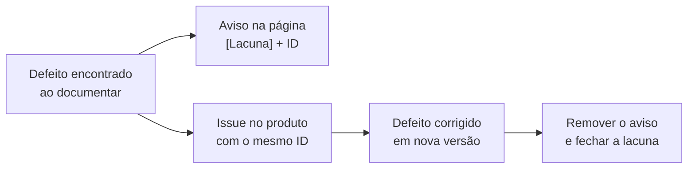

# Estudo de caso: o modelo B04-01 aplicado ao EcoColeta

**Atividade:** BIM04, Estudo de caso · **Equipe:** Rafael R. Lourenço, Guilherme, Geovanni, João Wilson · **Data:** 08/11/2026
**Caso estudado:** a documentação de usuário do app EcoColeta 2.0.0, entregue na prova B04 e escrita seguindo o modelo do B04-01

## 1. Resumo

Aplicamos o modelo B04-01 inteiro em um produto real e o avaliamos pelo que aconteceu na prática. O modelo é forte para **criar** uma documentação confiável. Por outro lado, ele **não cobre o que acontece depois da entrega**: como a documentação continua verdadeira quando o produto muda, e o que fazer com os defeitos do produto que a documentação revela.

Propomos acrescentar ao modelo uma seção de **manutenção e deriva**, com quatro partes:
- uma convenção para marcar textos de tela;
- uma verificação automática desses textos;
- gatilhos de revisão;
- um fluxo para encaminhar os defeitos do produto.

Testamos parte da proposta no próprio EcoColeta. Os números estão na seção 5.

## 2. O caso

O EcoColeta é um app Android (Flutter) para pedir a coleta de resíduos, com uma API Node.js e banco Firestore. A prova produziu 20 páginas: guia do cidadão, POP, estratégia, prompts, modelos, jornada, plano de teste, revisão adversarial e registro de lacunas. Usamos 10 dos 12 prompts do B04-01 e o checklist de saída completo.

## 3. Avaliação do modelo

### O que funcionou, com evidência do caso

| Recomendação do B04-01 | O que aconteceu no EcoColeta |
| --- | --- |
| "Distinguir o que está definido, proposto, implementado e verificado" | Virou as 5 marcações da prova. Isso nos impediu de afirmar que o app "acompanha o pedido", como diziam o site e o README: o código mostrou que não há acompanhamento. |
| "Não infira autoridade pelo nome ou localização" | O inventário encontrou 4 conflitos entre o código, o site e o README (C1 a C4). Sem essa regra, teríamos copiado o README. |
| "Não invente uma jornada real a partir de uma persona fictícia" | A jornada foi publicada como hipótese, e as fricções viraram perguntas para o teste com leitores. |
| Revisão adversarial (prompt 11) | Encontrou 14 defeitos comprovados. Dois deles podiam quebrar o app de todos os usuários (assinatura do APK) ou impedir o cadastro (e-mails `.com.br`). |
| POP com riscos antes dos passos | Os riscos irreversíveis da chave de assinatura ficaram visíveis antes da execução. |

### Limitações encontradas

| Limitação | Evidência no caso |
| --- | --- |
| **L-A. O modelo trata a documentação como uma entrega única.** O checklist de saída é uma foto do momento: "links, exemplos e imagens **foram** verificados". Não há regra para quando revisar de novo, quem é o dono de cada página nem o que dispara uma atualização (só o POP tem "owner e revisão"). | Já existia deriva **antes** da prova. O README dizia que o site não precisava mudar a cada versão, mas o site tem "Versão 2.0.0" escrito no texto. O README prometia "acompanhar o pedido", recurso que não existe. Ninguém percebeu porque não havia gatilho de revisão. |
| **L-B. O modelo não diz o que fazer com defeitos do produto que a documentação descobre.** Ele manda "apontar contradições e lacunas" na documentação, mas o caminho termina aí. | Ao documentar, descobrimos que o app **recusa e-mails `.com.br`** e que trocar o e-mail no perfil **pode trancar a conta**. A documentação ganhou avisos, mas o modelo não prevê levar isso ao time de produto nem retirar o aviso quando o defeito for corrigido. |
| **L-C. A citação literal de textos de tela não é verificável na prática.** O modelo pede exemplos verificados, mas não diz como manter verificados os textos da interface, que mudam a cada versão. | A prova cita **72 textos de tela** copiados do código. Qualquer mudança em um botão desatualiza várias páginas em silêncio (seção 5). |

Também notamos dois pontos menores, que deixamos de fora da proposta para manter o foco: o B04-01 não trata da segurança da informação em documentação pública (a revisão encontrou uma justificativa falsa sobre "riscos internos não expostos") nem da forma de declarar o uso de assistentes de IA, embora o banco de prompts pressuponha esse uso.

## 4. Proposta: seção "Manutenção e deriva" para o B04-01

A **deriva** (*drift*) acontece quando o produto muda e a documentação não acompanha. A proposta tem quatro partes. Cada uma é pequena e pode ser adotada sozinha.

### 4.1 Convenção única para texto de interface

Todo texto que aparece na tela é escrito **sempre do mesmo jeito**, e **só** ele. Na prova, os textos de tela estão em negrito, mas o negrito também foi usado para dar ênfase ("**três campos**", "**sem pedir confirmação**"). Por isso uma máquina não consegue separar os dois casos.

**Regra proposta:** texto de interface em negrito, sempre; ênfase em itálico, nunca em negrito. Textos de tela dentro de tabelas também ficam em negrito.

### 4.2 Verificação automática dos textos de tela

Um script lista todos os textos de interface marcados (regra 4.1) e confere se cada um ainda existe no código-fonte da versão documentada. Ele roda no CI a cada *push*, como recomenda o *Docs as code* do Write the Docs, e **falha** quando um texto some. O código está no Apêndice A.

### 4.3 Gatilhos de revisão por página

Cada página declara, no rodapé que a prova já tem, **de quais arquivos ela depende**, **quem é o dono** e **até quando a revisão vale**. Exemplo:

```text
Fontes: lib/screens/tela_inicial.dart, lib/core/coleta_service.dart
Dono: Guilherme · Revisada em: 08/11/2026 · Revisar até: 08/05/2027 ou quando uma fonte mudar
```

Quando um commit altera um arquivo listado, a revisão do commit deve incluir a página. Isso pode ser automatizado depois, com o mesmo script.

### 4.4 Fluxo para defeito do produto descoberto ao documentar



*Figura 1. Descrição em texto: ao encontrar um defeito do produto, a equipe faz duas coisas ao mesmo tempo: coloca um aviso [Lacuna] na página e abre uma issue no produto com o mesmo identificador. Quando a correção sai em uma nova versão, o aviso é removido e a lacuna é fechada. Assim o aviso não fica para sempre nem some antes da hora.*

### 4.5 Novo item no checklist de saída e novo prompt

Item proposto para o **Checklist de saída**:

> ☐ Cada página tem dono, fontes e prazo de revisão; os textos de interface seguem a convenção e passam na verificação automática; os defeitos do produto descobertos viraram issues com ID.

**Prompt 13, Detecção de deriva** (no mesmo formato dos prompts do B04-01):

```text
Compare a documentação [caminho] com o produto na versão [versão/commit].
Liste: textos de interface citados que não existem mais no código; páginas
cujas fontes mudaram desde a data de revisão; avisos [Lacuna] cujo defeito
já foi corrigido; e afirmações sobre comportamento que o código contradiz.
Para cada item: página, trecho, evidência (arquivo:linha), correção mínima.
Não edite. Não presuma que um texto ausente foi renomeado: aponte e pergunte.
```

## 5. Teste da proposta no EcoColeta

Aplicamos o script do Apêndice A à documentação entregue, **sem** ter adotado a convenção 4.1.

**Situação atual:**
- O script conferiu 132 trechos em negrito do guia.
- 72 existem no código ou no site. Todos os textos de tela citados estão corretos, então **não há deriva hoje**.
- Os outros 60 são ênfases, e não textos de tela. São falsos alarmes causados pela falta da convenção.

**Simulação de mudança no app:** trocamos um texto no código (em memória) e contamos quantas menções na documentação ficariam erradas e quantas o script detectaria.

| Mudança simulada no app | Menções na documentação | Detectadas pelo script | Não detectadas |
| --- | --- | --- | --- |
| "Minhas Coletas" → "Meus Pedidos" | 13 em 8 arquivos | 7 | 6 |
| "Email ou senha inválidos" → "E-mail ou senha incorretos" | 4 em 4 arquivos | 2 | 2 |
| "Confirmar Solicitação" → "Enviar Pedido" | 5 em 4 arquivos | 1 | 4 |
| **Total** | **22** | **10 (45%)** | **12** |

**Leitura dos resultados:**
- **Sem verificação**, as 22 menções ficariam erradas em silêncio, porque o modelo atual não tem nenhum mecanismo para isso.
- **Com o script e sem convenção**, 45% seriam detectadas. As outras 12 estão em tabelas sem negrito, em diagramas ou na pasta de processo.
- **Com a convenção 4.1**, todas as menções no guia passariam a ser verificáveis. Esse é o ganho esperado, mas **ainda não foi medido**: exigiria reescrever o guia com a convenção.

## 6. Limites da proposta

- A verificação confere se o **texto existe**, e não se o **comportamento** descrito continua verdadeiro. Se um botão mantiver o nome e mudar de função, o script não percebe. Para isso continuam valendo o gatilho 4.3 e a revisão humana.
- Textos montados em tempo de execução, como "Bem-vindo, *nome*!", precisam de um tratamento à parte.
- Textos de **outros sistemas**, como os botões do Android ("Abrir", "Configurações"), não estão no nosso código e não podem ser verificados assim. A convenção precisa de uma segunda marcação para eles, ou de uma lista de exceções.
- A simulação usou 3 mudanças escolhidas por nós. Ela mostra o mecanismo, mas não mede a frequência real de deriva no projeto.
- A proposta acrescenta trabalho (dono, prazo, convenção). Para uma documentação pequena, o gatilho 4.3 sozinho talvez basta.

## 7. Conclusão

O B04-01 resolveu bem o problema de **escrever certo**: no EcoColeta, ele nos impediu de copiar afirmações falsas do README e revelou defeitos reais do app. O ponto que ele não cobre é **continuar certo**. A documentação nasce verificada e começa a envelhecer no primeiro commit seguinte. A seção "Manutenção e deriva" fecha essa lacuna com regras pequenas e verificáveis, e o teste no próprio caso mostrou que a parte automática funciona quando os textos de interface seguem uma convenção única.

---

## Apêndice A: script de verificação de textos de interface

Node.js, sem dependências. Ele lê os textos em negrito do guia e procura cada um no código do app, da API e do site.

```js
import { readFileSync, readdirSync, statSync } from 'node:fs';
import { join } from 'node:path';

const arquivos = d => readdirSync(d).flatMap(f =>
  statSync(join(d, f)).isDirectory() ? arquivos(join(d, f)) : [join(d, f)]);
const fontes = [...arquivos('lib'), ...arquivos('../ecocoleta_api/src'), 'site/index.html']
  .map(f => readFileSync(f, 'utf8')).join('\n');

const ausentes = [];
for (const f of readdirSync('docs/usuario/guia')) {
  const md = readFileSync(join('docs/usuario/guia', f), 'utf8');
  for (const [, texto] of md.matchAll(/\*\*([^*]+)\*\*/g)) {
    if (texto.startsWith('[')) continue;           // marcações de estado
    if (!fontes.includes(texto)) ausentes.push(`${f}: ${texto}`);
  }
}
if (ausentes.length) { console.error(ausentes.join('\n')); process.exit(1); }
console.log('Textos de interface: OK');
```

*Com a convenção 4.1 adotada, todo negrito é texto de tela, então qualquer ausência indica deriva e faz o CI falhar.*

*Teste em 08/11/2026: rodando este script na documentação atual, que ainda não segue a convenção, ele falha e aponta 102 trechos. Conferimos a lista: **nenhum** é deriva real do app. São ênfases ("três campos"), rótulos do cabeçalho ("Tipo:"), o modelo "Bem-vindo, …" e textos da tela do Android ("Abrir", "Configurações", "Downloads").*
