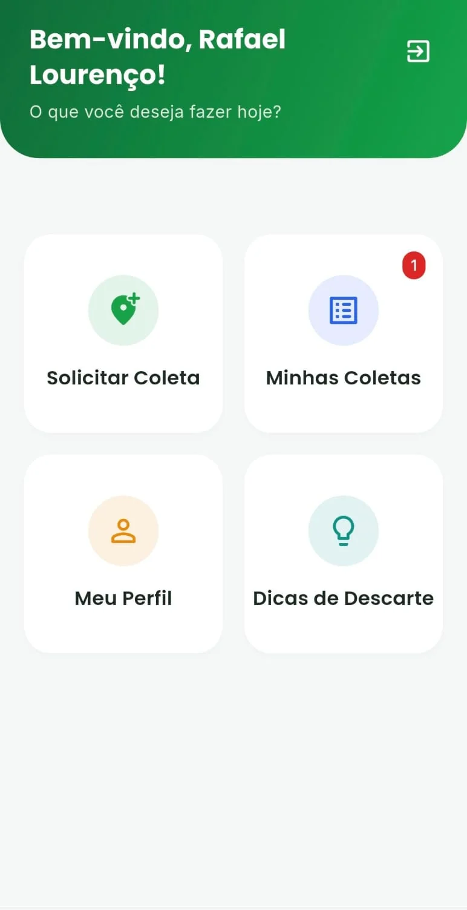
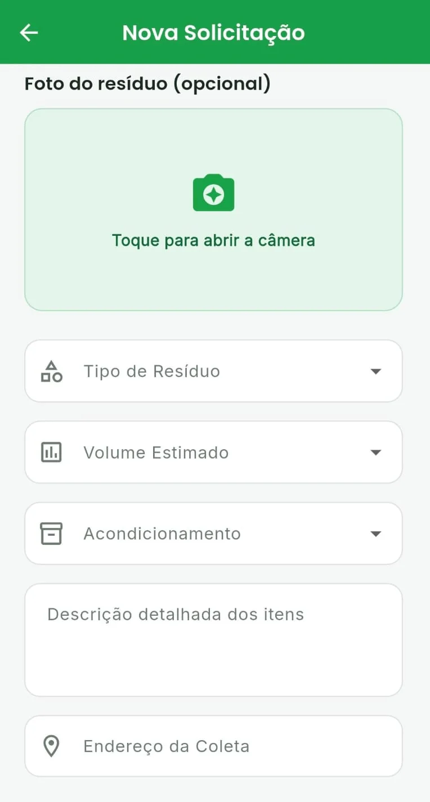

# Sua primeira coleta

> **Tipo:** tutorial · **Para:** quem nunca usou o EcoColeta · **Versão:** app 2.0.0 · [Voltar ao início](../README.md)

Neste tutorial você instala o app, cria uma conta e registra um pedido de coleta. Ao final, o pedido aparece na sua lista de solicitações. Leva cerca de 10 minutos.

## Antes de começar

Você vai precisar de:

- um celular **Android 7.0 ou mais novo**, conectado à internet (o app não existe para iPhone);
- um **CPF ou CNPJ** válido;
- um **e-mail** e um **telefone com DDD**;
- o **endereço** onde o resíduo está;
- se quiser mandar uma foto, o resíduo por perto. A foto é opcional.

## 1. Instale o app

1. No celular, abra [ecocoleta-app.netlify.app](https://ecocoleta-app.netlify.app) e toque em **Baixar APK**.
2. Abra o arquivo baixado. Se o Android pedir, autorize a instalação de apps dessa fonte.
3. Toque em **Instalar** e depois em **Abrir**.

Você verá a tela de entrada, verde, com o título **EcoColeta**.

Se a instalação for bloqueada, siga [Instalar o app no Android](02-instalar-o-app.md).

## 2. Crie sua conta

1. Na tela de entrada, toque em **Ainda não tem uma conta? Cadastre-se**.
2. Preencha os campos da tela **Criar Conta**:
   - **Nome Completo ou Razão Social**
   - **CPF ou CNPJ**: pode digitar com ou sem pontos e traços.
   - **Endereço Completo**
   - **Telefone / WhatsApp**: com DDD, por exemplo `(11) 98765-4321`.
   - **E-mail**: **[Lacuna]** na versão 2.0.0, e-mails terminados em `.com.br` (ou com mais de um ponto depois do @, ou com `+`) são recusados. Se o seu for assim, use outro, como um Gmail ou Outlook `.com`. Veja [Campos e regras](07-campos-e-regras.md#cadastro).
   - **Senha**: pelo menos 6 caracteres.
3. Toque em **Finalizar Cadastro**.

> **A primeira resposta pode demorar.** Se o serviço ficou um tempo sem uso, ele leva de 20 a 50 segundos para responder. Espere o botão parar de girar e não toque nele de novo. [Entenda o motivo](06-como-funciona.md#por-que-o-primeiro-acesso-demora).

Aparece a mensagem verde **Conta criada com sucesso!** e o app volta para a tela de entrada. O cadastro **não** faz o login automaticamente.

Se algum campo ficar vermelho, leia a mensagem embaixo dele. As regras de cada campo estão em [Campos e regras](07-campos-e-regras.md).

## 3. Entre no app

1. Digite o **E-mail** e a **Senha** que você acabou de cadastrar.
2. Toque em **Entrar**.

Se o botão girar por algum tempo, espere: é o mesmo motivo do passo anterior.

Você verá **Bem-vindo, seu nome!** e quatro botões: **Solicitar Coleta**, **Minhas Coletas**, **Meu Perfil** e **Dicas de Descarte**.

## 4. Peça a coleta

1. Toque em **Solicitar Coleta**. Abre a tela **Nova Solicitação**.
2. *(Opcional)* Toque na área **Toque para abrir a câmera** e fotografe o resíduo. Para trocar a foto, toque na área de novo.
3. Em **Tipo de Resíduo**, escolha a opção que mais se parece com o seu descarte. Na dúvida, consulte [Tipos de resíduo](08-residuos-e-dicas.md).

   *Use os dados do seu descarte real. Os exemplos abaixo são para um monitor velho. Se estiver só testando, exclua o pedido no final (veja [Editar ou excluir](04-editar-ou-excluir-solicitacao.md#excluir)).*
4. Em **Volume Estimado**, escolha o tamanho, por exemplo **Até 0,5m³** (até 500 litros).
5. Em **Acondicionamento**, escolha como o material está guardado, por exemplo **Sacos Plásticos**.
6. Em **Descrição detalhada dos itens**, escreva o que será coletado, por exemplo `Um monitor e dois teclados velhos`.
7. Em **Endereço da Coleta**, digite o endereço completo. Ele **não** vem preenchido com o endereço do cadastro.
8. Toque em **Confirmar Solicitação**.

Aparece **Solicitação enviada com sucesso!** e o app volta para a tela inicial.

## 5. Confira o seu pedido

1. Toque em **Minhas Coletas**. O número no canto do botão mostra quantas solicitações você tem.
2. A lista **Minhas Solicitações** mostra o seu pedido com o tipo de resíduo e o endereço.

Pronto: sua primeira solicitação está registrada.

## O que você aprendeu

Você instalou o app, criou uma conta, entrou, registrou uma solicitação e a encontrou na lista.

## Próximos passos

- Errou algum dado? Veja [Editar ou excluir uma solicitação](04-editar-ou-excluir-solicitacao.md).
- Quer saber quando a coleta vai acontecer? Veja a resposta em [Perguntas frequentes](10-perguntas-frequentes.md#quando-a-coleta-vai-acontecer).

---

*Fontes: `lib/screens/tela_login.dart`, `tela_cadastro.dart`, `tela_inicial.dart`, `tela_formulario.dart` (v2.0.0); site oficial, seção Instalar. Estado: **[Implementado]**. O caminho completo ainda não foi testado com um leitor; veja o [plano de teste](../processo/06-plano-de-teste-com-leitores.md).*
