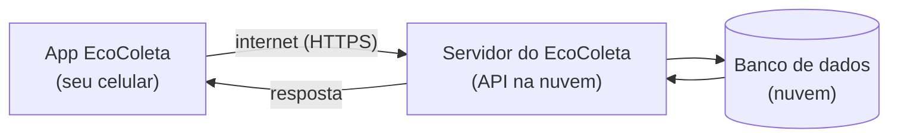
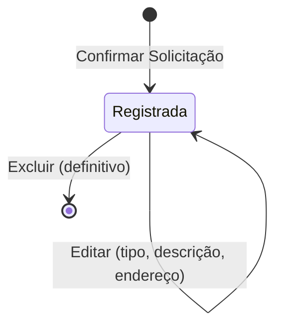

# Como o EcoColeta funciona

> **Tipo:** explicação · **Para:** quem quer entender o que acontece com o pedido e com os dados · **Versão:** app 2.0.0 · [Voltar ao início](../README.md)

## Em uma frase

O app no seu celular não guarda nada: tudo o que você digita vai pela internet para um servidor do EcoColeta, que grava no banco de dados e devolve a resposta.

## O caminho de um pedido

*Figura 1. Descrição em texto: o app envia os dados pela internet, por conexão segura (HTTPS), ao servidor do EcoColeta. O servidor grava e consulta o banco de dados e devolve a resposta ao app. O app nunca acessa o banco diretamente.*

Isso explica três comportamentos do app:

- **Sem internet, nada funciona.** Nem o login nem a lista de pedidos ficam guardados no celular.
- **Desinstalar o app não apaga a sua conta.** Ela fica no servidor.
- **Você pode entrar pelo celular de outra pessoa** com o seu e-mail e senha e vai ver os seus pedidos.

## Por que o primeiro acesso demora

O servidor do EcoColeta usa um plano gratuito de hospedagem que **desliga o servidor depois de alguns minutos sem uso**. Quando alguém volta a usar, ele precisa ser ligado de novo, o que leva **de 20 a 50 segundos**. Depois disso as respostas são rápidas.

**[Verificado]** Em 08/11/2026, a primeira chamada ao servidor parado levou 22 segundos. Por isso o app espera até 70 segundos no login antes de mostrar erro de conexão.

## O ciclo de vida de uma solicitação

*Figura 2. Descrição em texto: ao tocar em Confirmar Solicitação, o pedido fica registrado. Enquanto existe, ele pode ser editado quantas vezes quiser, e continua registrado. Excluir apaga o pedido de forma definitiva. Na versão 2.0.0 não existem outros estados.*

### O que o app ainda não faz

Na versão 2.0.0 a solicitação **não tem situação** ("pendente", "agendada", "coletada"), **data marcada** nem **aviso** quando a coleta acontece. O app registra o pedido e permite editar ou excluir. **[Implementado]**

O número que aparece no botão **Minhas Coletas** é o **total de solicitações** da sua conta, e não o total de coletas pendentes.

**[Lacuna]** Ainda não está definido quem faz a coleta, como a equipe de coleta recebe os pedidos e em quanto tempo atende. Essas definições estão em [Lacunas e decisões](../processo/08-lacunas-e-decisoes.md).

## Seus dados

| Dado | Onde fica | Quem vê no app |
| --- | --- | --- |
| Nome, CPF/CNPJ, endereço, telefone, e-mail | Banco de dados na nuvem | Você, na tela **Meu Perfil** (o CPF/CNPJ não aparece) |
| Senha | Banco de dados, **embaralhada** (hash bcrypt) | Ninguém, nem a equipe consegue lê-la |
| Solicitações e fotos | Banco de dados na nuvem | Você, em **Minhas Coletas** (a foto não aparece na lista) |

A foto é reduzida no próprio celular (até 800 × 800 pixels, qualidade baixa) antes do envio, para gastar menos internet. **[Implementado]**

**[Lacuna]** O projeto ainda não tem política de privacidade publicada nem opção de apagar a conta pelo app. A proteção de acesso aos dados no servidor também está em revisão pela equipe. Veja [Perguntas frequentes](10-perguntas-frequentes.md#como-apago-minha-conta).

---

*Fontes: README do repositório (arquitetura); `lib/core/api_constants.dart`, `usuario_service.dart`, `tela_formulario.dart`, `tela_inicial.dart`; API `index.js` e rotas. Tempo de 22 s medido com uma chamada ao endereço raiz da API em 08/11/2026. Os diagramas usam Mermaid, que o GitHub desenha; o texto abaixo de cada figura tem a mesma informação.*
