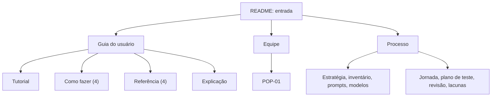

# Estratégia de documentação

> **Tipo:** explicação · **Para:** a equipe e o avaliador · **Base:** documento B04-01, "Dicas para documentação" · [Voltar ao início](../README.md)

## Objetivo

Fazer com que **um cidadão sem conhecimento técnico** consiga instalar o EcoColeta, pedir uma coleta e resolver os problemas mais comuns **sem precisar perguntar a ninguém**, e fazer com que a equipe publique versões sem quebrar o app de quem já o instalou.

O B04-01 diz que "o objetivo não é produzir mais páginas". Por isso cada página existe para **uma tarefa** de **um leitor**. Quando uma página não tinha tarefa própria, ela foi juntada a outra.

## Respostas às perguntas do B04-01

| Pergunta do B04-01 | Resposta para o EcoColeta |
| --- | --- |
| Quem vai usar e o que precisa fazer? | **L1, cidadão ou empresa:** instalar, pedir, corrigir e cancelar coletas. **L2, equipe:** publicar versões e atender dúvidas. **L3, avaliador:** entender o processo e a qualidade. |
| Qual fonte determina o comportamento? | O código da versão 2.0.0 (app e API). Ordem de autoridade no [README da documentação](../README.md#fontes-canônicas). |
| Qual versão, plataforma e contexto? | App 2.0.0 (build 2), Android 7.0 ou superior, API em produção, commit `72d03da`, novembro de 2026. |
| Qual gênero? | Escolhido pela tarefa (tabela abaixo). |
| O que fica aqui e o que tem fonte própria? | Detalhes técnicos de desenvolvimento ficam no README do repositório. Regras de campo ficam numa única página de referência, e as outras páginas apenas apontam para ela. |
| Como verificar? | Testes automatizados, conferência de links e da API no ar, revisão adversarial e teste com leitores ([plano](06-plano-de-teste-com-leitores.md)). |
| O que ainda não sabemos? | Está registrado em [Lacunas e decisões](08-lacunas-e-decisoes.md) e marcado como **[Lacuna]** nas páginas. |

## Gêneros (Diátaxis) aplicados

| O leitor quer... | Gênero | Páginas |
| --- | --- | --- |
| aprender fazendo | Tutorial | [Sua primeira coleta](../guia/01-primeira-coleta.md) |
| cumprir uma tarefa específica | Como fazer (how-to) | [Instalar](../guia/02-instalar-o-app.md), [Entrar e sair](../guia/03-entrar-e-sair.md), [Editar ou excluir](../guia/04-editar-ou-excluir-solicitacao.md), [Perfil](../guia/05-atualizar-perfil.md) |
| consultar um dado exato | Referência | [Campos](../guia/07-campos-e-regras.md), [Resíduos](../guia/08-residuos-e-dicas.md), [Mensagens](../guia/09-mensagens-e-solucoes.md), [FAQ](../guia/10-perguntas-frequentes.md) |
| entender o porquê | Explicação | [Como funciona](../guia/06-como-funciona.md), esta página |
| executar uma operação repetível com risco | POP | [Publicar nova versão](../equipe/pop-publicar-nova-versao.md) |
| descobrir onde a pessoa trava | Jornada | [Solicitar coleta](05-jornada-solicitar-coleta.md), como hipótese |

## Como evoluímos o B04-01

O B04-01 é genérico. Para o EcoColeta, adaptamos assim:

1. **Marcações de estado em texto.** O B04-01 pede para separar o que é "definido, proposto, implementado e verificado". Criamos cinco marcações fixas, sempre escritas por extenso: **[Verificado]**, **[Implementado]**, **[Criado pela equipe]**, **[Proposto]** e **[Lacuna]**. Elas não dependem de cor, o que atende ao checklist de acessibilidade.
2. **Mensagens copiadas literalmente do código.** As mensagens de erro foram extraídas do código-fonte, e não digitadas de memória. Assim o leitor encontra na documentação exatamente a frase que viu na tela.
3. **Rodapé de fontes nas páginas do guia e no POP.** Cada uma termina dizendo quais arquivos sustentam o que ela afirma. As páginas de processo citam as fontes no próprio texto.
4. **Divergências viram registro, não correção silenciosa.** Quando o código, o site e o README discordam, a divergência é registrada na [revisão](07-revisao-adversarial.md), e a página não escolhe uma versão sem avisar.
5. **Prompts próprios.** Os prompts do B04-01 foram preenchidos com o contexto real do projeto. Veja o [banco de prompts](03-prompts.md).
6. **Modelos reutilizáveis.** Cada gênero tem um esqueleto fixo. Veja os [modelos](04-modelos.md).
7. **Jornada marcada como hipótese.** Ainda não houve pesquisa com usuários reais, então a jornada é uma hipótese a validar e não "a jornada real".

## Arquitetura de conteúdo

*Figura 1. Descrição em texto: o README é a única entrada. Ele leva a três grupos. O Guia do usuário tem 1 tutorial, 4 páginas de como fazer, 4 de referência e 1 de explicação. Equipe tem o POP-01. Processo tem a estratégia, o inventário, os prompts, os modelos, a jornada, o plano de teste, a revisão e as lacunas.*

**O README é só navegacional.** Ele não repete regras: só diz qual página responde a qual pergunta.

**Fontes canônicas por assunto:**

| Assunto | Página canônica | Quem só aponta para ela |
| --- | --- | --- |
| Regras de campos e mensagens de campo | Campos e regras | Tutorial, Perfil |
| Mensagens da faixa inferior | Mensagens e soluções | Entrar e sair, Editar ou excluir |
| Tipos de resíduo, volume, acondicionamento | Resíduos e dicas | Tutorial, Campos |
| Por que o primeiro acesso demora | Como funciona | Tutorial, Entrar e sair, Mensagens |
| O que não sabemos | Lacunas e decisões | Todas as páginas com [Lacuna] |

## Docs as code

A documentação fica no mesmo repositório do app, em Markdown, e é versionada pelo Git junto com o código. Uma mudança no app que altere um texto da tela deve trazer, **no mesmo commit**, a atualização da página canônica correspondente. O PDF é gerado a partir dos `.md` pelo script `docs/usuario/gerar-pdf.mjs`, que fica no repositório do projeto e não faz parte do pacote entregue. Por isso o PDF nunca é editado à mão.

## Critérios de aceite

A documentação está pronta quando:

1. todos os itens do **Checklist de saída** do B04-01 forem atendidos (conferido na [revisão](07-revisao-adversarial.md#checklist-de-saída-do-b04-01));
2. todos os links internos e externos funcionarem (verificação automática do `gerar-pdf.mjs`);
3. pelo menos 4 de 5 participantes concluírem o tutorial sem ajuda no teste com leitores **([Proposto]**, ainda não executado).
